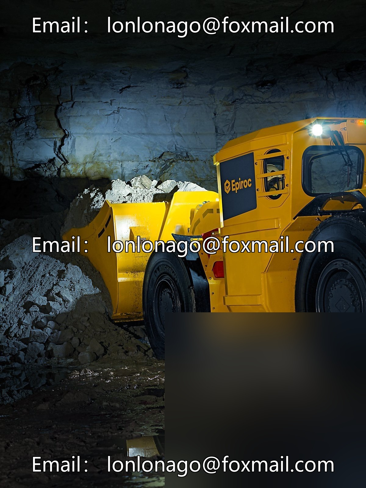
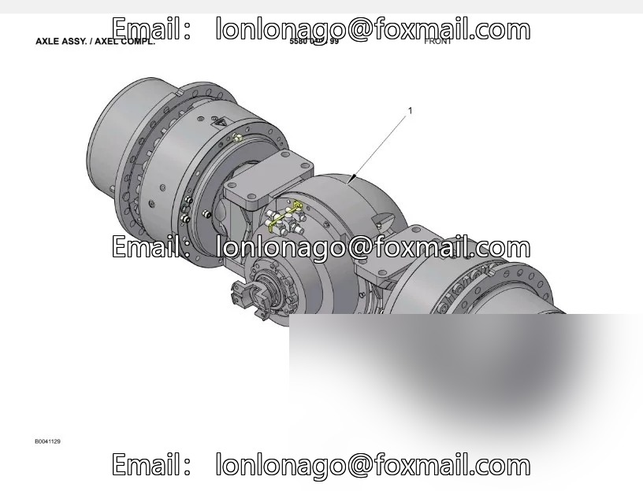
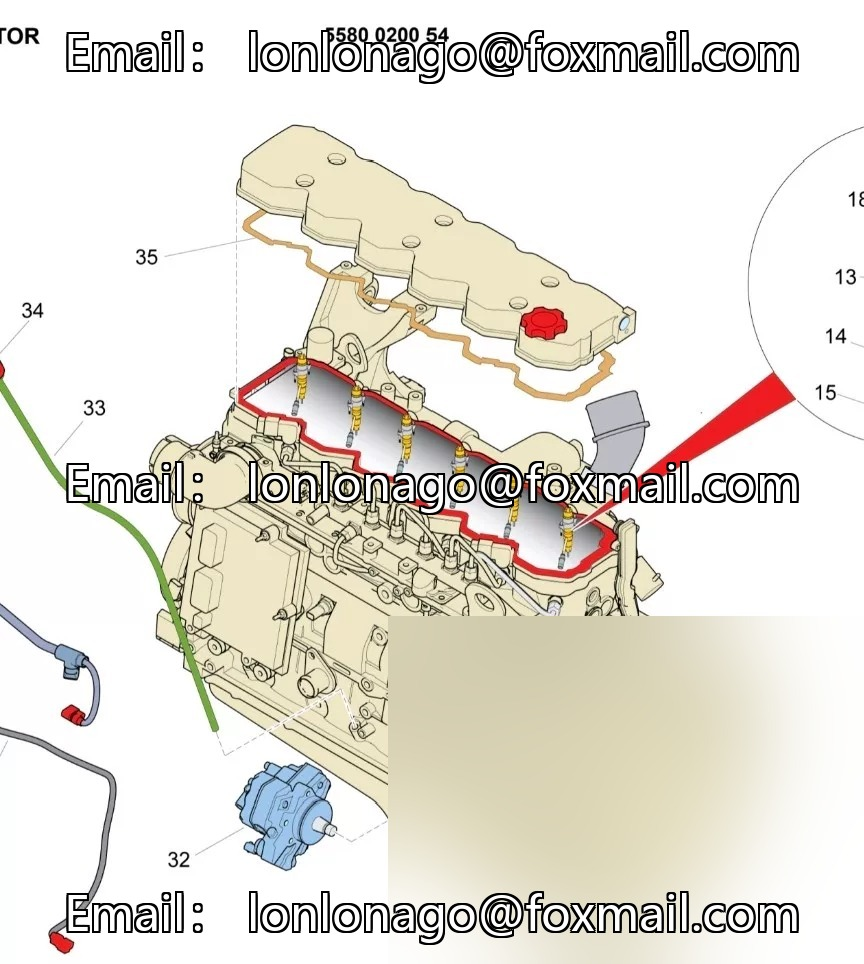
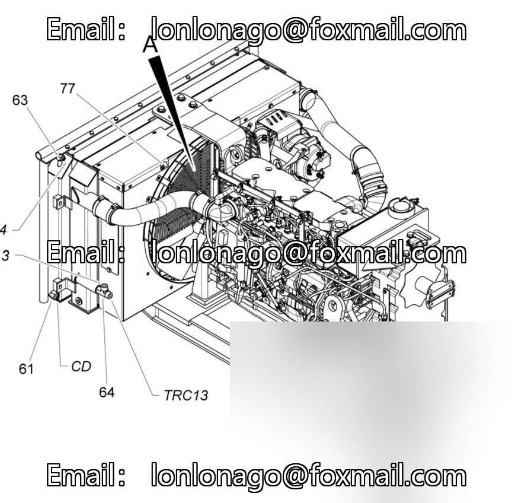
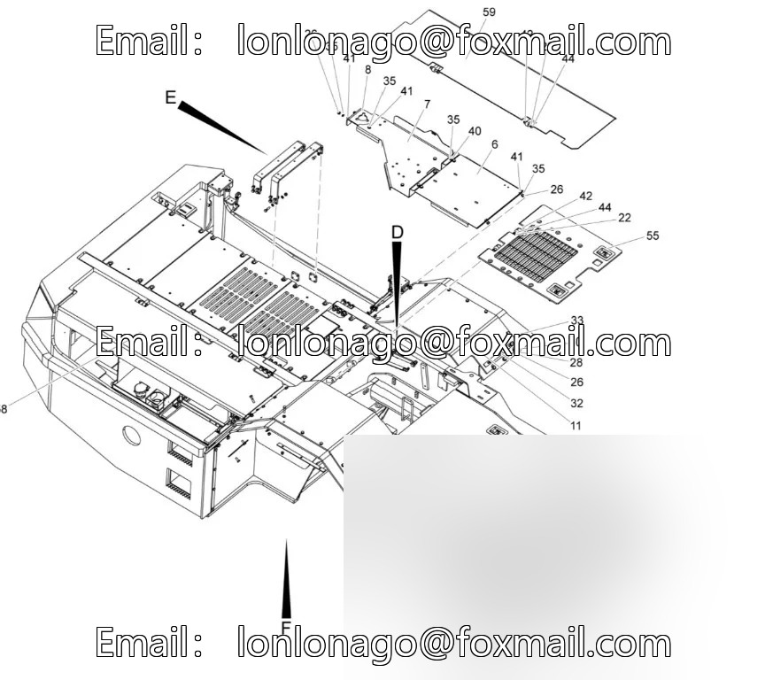

# Atlas Copco Scooptram

## Body

Atlas Copco Scooptram ST7 underground diesel shovel-transport unit spare parts catalog, PDF , 830 pages.

Applicable to scenarios such as underground metal mines, quarrying sites, and other conditions, core features are: articulated frame, high-power diesel engine, efficient hydraulic system, ISO ROPS/FOPS cab, advanced computer control system (RCS).
37174
automatic shipment, does not support return.

The catalog is a PDF with 830 pages covering underground metal mining, quarrying and other conditions; it includes an articulated frame, high-power diesel engine, efficient hydraulic system, ISO ROPS/FOPS cab and advanced computer control system (RCS).

<!-- AI_ENRICHED -->

## Images

## Payment

Here is a pay link on Stripe ( https://buy.stripe.com/3cs8yP7sY87d0vu9AB ). Please contact me lonlonago@foxmail.com after funding $89, and I will send you a complete data files , thank you!

